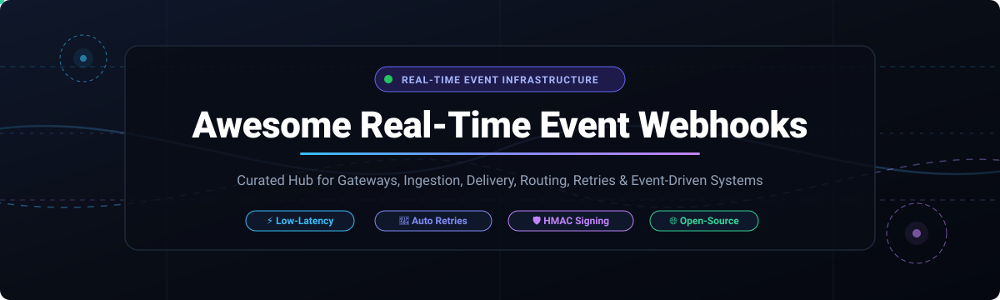

# ⚡ Awesome Real-Time Event Webhooks 🚀

  

  <strong>A curated index of top real-time event webhook platforms, event-driven gateways, delivery architectures, and open-source tools for enterprise ingestion, routing, transformations, and retries at scale.</strong>

  
  
  
  

> 🌟 **Welcome to the definitive guide to Real-Time Event Webhooks and Event-Driven Ingestion Infrastructure!** Whether you are looking for enterprise-grade Webhook-as-a-Service (WaaS), automated delivery proxies, testing inspectors, or self-hosted open-source webhook servers, this repository covers the best-of-breed solutions.
> 
> ⭐ **Star this repository** if you find it helpful for designing resilient, scalable event pipelines!

---

## 📑 Table of Contents

- [🌐 Sector Overview & Market Dynamics](#-sector-overview--market-dynamics)
- [☁️ SaaS & Hosted Platforms](#️-saas--hosted-platforms)
- [💻 Open-Source Software](#-open-source-software)
- [📊 Feature Comparison Matrix](#-feature-comparison-matrix)
- [🔍 Key Evaluation Criteria for Webhook Gateways](#-key-evaluation-criteria-for-webhook-gateways)
- [🤝 Contributing](#-contributing)
- [📄 License](#-license)

---

## 🌐 Sector Overview & Market Dynamics

The global **Event-Driven Architecture (EDA) & Real-Time Event Management market** is valued at approximately **$3.7B to $8.2B**, expanding rapidly at a Compound Annual Growth Rate (**CAGR**) of **18.4% to 21.5%** as enterprises transition away from polling toward asynchronous, event-driven microservices.

The webhook and event delivery sector is currently **moderately to highly fragmented** rather than a winner-take-all monopoly:
- **Broad Fragmentation Across Niches**: High-scale API platforms require purpose-built Webhooks-as-a-Service (WaaS) with consumer portals and signature verification (e.g., Svix, Convoy, Hook0).
- **Automation & iPaaS Overlap**: Workflow automation giants (Zapier, Celonis/Make) dominate multi-app orchestration, while developer gateways (Hookdeck, Outpost) bridge HTTP payloads directly into message queues (Kafka, AWS SQS, RabbitMQ).
- **Standardization Efforts**: Emerging standards like [Standard Webhooks](https://www.standardwebhooks.com/) are actively attempting to unify authentication, payload signing, and idempotency across disparate cloud ecosystems.

---

## ☁️ SaaS & Hosted Platforms

Commercial, cloud-hosted webhook infrastructure and real-time event platforms. Sorted by company size (valuation / ARR) in descending order:

| 🏢 Platform | 💰 Company Scale (Valuation / ARR) | 🏷️ Starting Paid Tier | 🎁 Free Tier Limit & Trial Period | 🎯 Primary Architecture & Capabilities |
|---|---|---|---|---|
| **[Make Webhooks](https://www.make.com/)** | **~$13B Valuation** (Parent Celonis) / **~$771M ARR** | **$9.00 / month** (Core plan, billed annually) or $10.59/mo | **1,000 operations/month** free forever (max 2 active scenarios, 15-min interval) | Visual scenario orchestration, custom webhooks, payload schemas & multi-part validation |
| **[Zapier Webhooks](https://zapier.com/)** | **~$5B Valuation** / **~$310M+ ARR** | **$19.99 / month** (Professional plan, billed annually) or $29.99/mo | **100 tasks/month** free forever (limited to 2-step single-trigger Zaps) | Event trigger (Catch Hook) and action publisher across 7,000+ cloud integrations |
| **[Chargebee Event Webhooks](https://www.chargebee.com/)** | **~$3.5B Valuation** / **~$115M–$300M ARR** | **$599.00 / month** (Performance plan, annual commitment) | **$250,000 cumulative lifetime billing** free forever (Starter tier) | Specialized subscription billing event dispatch, 7-attempt exponential retries |
| **[Pipedream](https://pipedream.com/)** | **~$80M Valuation** (Acquired by Workday) / **~$3.5M ARR** | **$19.00 / month** (Basic tier) or $99+/mo Team | **333 daily credits (~10,000 credits/month)** free forever (3 active workflows) | Code-first serverless webhook routing, Python/Node.js step transforms, event sources |
| **[Svix](https://www.svix.com/)** | **~$25M–$50M Valuation** (Series A) / **~$1M–$5M ARR** | **$20.00 / month** (Basic plan with 99.9% uptime SLA) | **50,000 messages/month** free forever (50 msg/sec, 7-day log retention) | Enterprise Webhooks-as-a-Service, hosted consumer portal, HMAC signatures, dead-letter queues |
| **[Courier Webhooks](https://www.courier.com/)** | **~$30M–$45M Valuation** (Series A) / Private VC | **$0 base / month + $0.005 per send** (Business tier overage) | **10,000 sends/month** free forever (Developer tier) | Notification orchestration delivering HTTP events to static & dynamic recipient endpoints |
| **[Hookdeck](https://hookdeck.com/)** | **~$15M–$30M Valuation** (Seed) / **~$1M ARR** | **$39.00 / month** (Team plan with unlimited team seats) | **100,000 requests/month** free forever (3-day event retention, 5 destinations) | Full event gateway, inbound queueing, replay, traffic throttling, Outpost outbound driver |
| **[RequestBin](https://requestbin.net/)** | **Subsidiary of Pipedream** / Developer Workspace | **$12.00 / month** (Pro plan with custom subdomains) | **3 bins, 500 requests/bin/day, 100 stored/bin** free forever | Webhook debugging workspace, HTTP mock APIs, live request forwarding rules & MCP AI integration |
| **[Webhook.site](https://webhook.site/)** | **Bootstrapped / Profitable Micro-SaaS** | **$9.00 / month** (Basic plan) or $19.00/mo Pro | **100 requests per URL, 7-day URL expiry** free forever | Instant inspection URL, programmable custom action flows, async background queues & cron schedules |

---

## 💻 Open-Source Software

Self-hosted, community-driven event webhook servers, proxies, and gateways. Repositories are equipped with live social star badges and sorted by GitHub stars in descending order:

| 📦 Repository & Project | 🌟 GitHub Stars Badge | 🛠️ Tech Stack & License | 🚀 Architecture & Key Strengths |
|---|---|---|---|
| **[webhook](https://github.com/adnanh/webhook)** |  | Go • MIT | Lightweight, battle-tested incoming webhook server to trigger shell scripts, commands, and automation hooks |
| **[webhook.site](https://github.com/webhooksite/webhook.site)** |  | PHP / Laravel / Vue.js • MIT | Open-source core of Webhook.site for capturing, inspecting, parsing, and testing incoming HTTP payloads |
| **[svix-webhooks](https://github.com/svix/svix-webhooks)** |  | Rust • MIT / Apache-2.0 | High-performance enterprise webhooks-as-a-service backend featuring endpoint catalogs, HMAC signing, and retries |
| **[convoy](https://github.com/frain-dev/convoy)** |  | Go / PostgreSQL / Redis • MPL-2.0 | Scalable full-cycle webhook gateway handling millions of incoming and outgoing events with customer-facing portals |
| **[standard-webhooks](https://github.com/standard-webhooks/standard-webhooks)** |  | Specification / Multi-Lang • Apache-2.0 | Formal open industry specification & SDKs for webhook signatures, timestamp verification, and symmetric security |
| **[hook0](https://github.com/hook0/hook0)** |  | Rust / PostgreSQL • SSPL-1.0 | Open-source webhooks-as-a-service with complete cloud-to-self-hosted parity and multi-tenant tag filtering |
| **[laravel-webhook-client](https://github.com/spatie/laravel-webhook-client)** |  | PHP / Laravel • MIT | Robust inbound webhook receiving package with built-in signature verification, profile handling, and background job queues |
| **[captainhook](https://github.com/captainhook-git/captainhook)** |  | PHP • MIT | Very flexible Git and repository lifecycle webhook orchestrator for automated CI/CD and deployment hooks |
| **[webhookd](https://github.com/ncarlier/webhookd)** |  | Go • MIT | Minimalist, robust webhook listener server designed to run shell scripts and trigger background jobs via HTTP POST |
| **[laravel-webhook-server](https://github.com/spatie/laravel-webhook-server)** |  | PHP / Laravel • MIT | Complete outbound webhook dispatcher library supporting backoff retries, secret signing, and status tagging |
| **[outpost](https://github.com/hookdeck/outpost)** |  | Go • Apache-2.0 | Hookdeck's outbound event delivery engine dispatching to Webhooks, AWS SQS, RabbitMQ, Kafka, and GCP Pub/Sub |
| **[webhook-tester](https://github.com/tarampampam/webhook-tester)** |  | Go / React • MIT | Self-hosted microservice and real-time web UI to test and inspect HTTP webhook callbacks with WebSocket push |
| **[webhookx](https://github.com/webhookx-io/webhookx)** |  | Go • Apache-2.0 | GitOps-oriented webhook gateway supporting WASM plugins, event fanout, rate limiting, and distributed deliveries |

---

## 📊 Feature Comparison Matrix

| Project / Software | Primary Direction | HMAC / Signature Signing | Auto Retries & Exponential Backoff | Ingestion Throttling / Queues | Consumer Portal UI | Self-Hostable |
|---|---|---|---|---|---|---|
| **Make Webhooks** | Inbound / Outbound | ⚠️ API Key / Token | ✅ Automated Reschedule | ✅ High-Throughput Buffering | ❌ Built-in Scenarios | ❌ SaaS Only |
| **Zapier Webhooks** | Inbound / Outbound | ⚠️ Basic / Custom Headers | ✅ Zapier Errored Replay | ✅ Internal Task Queue | ❌ Zapier Dashboard | ❌ SaaS Only |
| **Chargebee** | Outbound (Billing) | ❌ Basic Auth Only | ✅ 7 Attempts / 2 Days | ✅ Distributed Queue | ✅ Merchant Portal | ❌ SaaS Only |
| **Pipedream** | Inbound / Outbound | ✅ HMAC via Code Steps | ✅ Auto Retries / Dead-Letter | ✅ Managed Event Stream | ❌ Developer Console | ❌ Cloud / Enterprise |
| **Svix** | Outbound & Relay | ✅ HMAC-SHA256 (Standard) | ✅ Configurable Schedule | ✅ Rate Limiting & DLQ | ✅ White-label Portal | ✅ Open Core (Rust) |
| **Courier** | Outbound (Notifications) | ✅ Provider Overrides | ✅ Fallback Routing | ✅ Delivery Queues | ❌ Notification Logs | ❌ SaaS Only |
| **Hookdeck** | Inbound & Outbound | ✅ Automatic Verification | ✅ Exponential Retries | ✅ Ingestion Queue & Buffer | ✅ User Portal (Outpost)| ✅ Outpost Engine (Go) |
| **RequestBin** | Inbound (Debug/Forward) | ⚠️ Custom Header Pass-through | ✅ Live Auto-Forwarding | ✅ Bin Request Buffering | ❌ Debug Workspace | ❌ SaaS Only |
| **Webhook.site** | Inbound (Inspector) | ⚠️ Pass-through / Custom Actions| ✅ Queue Throttling Rules | ✅ Custom Async Queues | ❌ Webhook Inspector | ✅ Open-Source Core |
| **Convoy** | Inbound & Outbound | ✅ HMAC Verification & Signing | ✅ Exponential Backoff | ✅ Ingestion & Delivery Queues | ✅ Customer Portal | ✅ Fully Self-Hosted (Go)|
| **Hook0** | Outbound | ✅ HMAC-SHA256 Signatures | ✅ Escalating Backoff & DLQ | ✅ PostgreSQL / Pulsar Queue | ✅ Tenant Management UI| ✅ Fully Self-Hosted (Rust)|
| **Outpost** | Outbound Multi-Broker | ✅ Signature Verification | ✅ At-Least-Once Delivery | ✅ Message Broker Fanout | ✅ Consumer Management | ✅ Fully Self-Hosted (Go)|
| **WebhookX** | Inbound & Outbound | ✅ WASM / Built-in Plugin | ✅ Configurable Retry Policies | ✅ Rate Limiter Engine | ❌ Declarative Admin API | ✅ Fully Self-Hosted (Go)|
| **ADNANH Webhook**| Inbound (Exec Shell) | ⚠️ Secret Token / Param Matching | ❌ Delegate to Subprocess | ❌ OS Process Level | ❌ Headless Daemon | ✅ Fully Self-Hosted (Go)|

---

## 🔍 Key Evaluation Criteria for Webhook Gateways

When selecting or architecting a webhook infrastructure for production workloads, consider these mission-critical dimensions:

1. **🔐 Cryptographic Integrity & HMAC Signatures**:
   Always require cryptographic signing using standard HMAC algorithms (e.g., HMAC-SHA256) combined with epoch timestamp validation to defend against replay attacks (adhering to [Standard Webhooks](https://www.standardwebhooks.com/)).
2. **🛡️ Ingestion Spikes & Queuing Buffers**:
   Webhook senders can generate sudden bursts of thousands of events per second. A dedicated gateway buffer (using Redis, Apache Pulsar, or SQS) absorbs traffic spikes to safeguard downstream endpoints from cascading 504 Gateway Timeouts.
3. **🔄 Exponential Retries & Dead Letter Queues (DLQ)**:
   Receiving servers experience transient downtime, network partitions, and database locks. Resilient webhook providers implement escalating backoff schedules (e.g., immediate, 5s, 1m, 15m, 1h, 6h, 24h) and preserve failed payloads in a DLQ for manual inspection and replay.
4. **👥 Multi-Tenant Customer Portals**:
   If building a B2B SaaS platform, offload customer support tickets by embedding a self-serve webhook portal where your enterprise clients can configure endpoints, rotate signing secrets, inspect delivery logs, and trigger event redeliveries independently.
5. **🧩 Transformation & Event Routing**:
   Filter events at the network boundary using dot-notation schemas (`order.created`, `invoice.payment_failed`) to prevent downstream systems from receiving irrelevant payloads.

---

## 🤝 Contributing

Contributions, feedback, and suggestions are welcome!

To propose a new open-source project or hosted service:
1. Fork this repository.
2. Create a new branch: `git checkout -b feature/add-new-webhook-tool`.
3. Add the project to the appropriate section in alphabetical or sorted order with accurate descriptions, verified license, and links.
4. Ensure any open-source addition has active maintenance (commits within the last 12 months).
5. Submit a pull request with a brief summary of why the tool stands out.

---

## 📄 License

This repository is curated and made available under the [Creative Commons Zero v1.0 Universal](LICENSE) (Public Domain Dedication). All third-party software products, brand names, and logos belong to their respective owners.

---

  Built with ❤️ by <a href="https://github.com/ishandutta2007">Ishan Dutta</a> and the open-source event-driven developer community.

